# NEXVARY Tower Guard

<strong>وعي بالشبكات الخلوية على جهازك · On-device cellular awareness</strong>

<a href="#العربية">العربية</a> · <a href="#english">English</a> · <a href="https://github.com/nexvary/NEXVARY-Tower/releases/tag/v0.7.0">Release 0.7.0</a>

<table align="center">
  <tr>
    <td width="50%" align="center"><a href="https://github.com/nexvary/NEXVARY-Tower/releases/download/v0.7.0/NEXVARY-Tower-Guard-0.7.0-vc10-release.apk">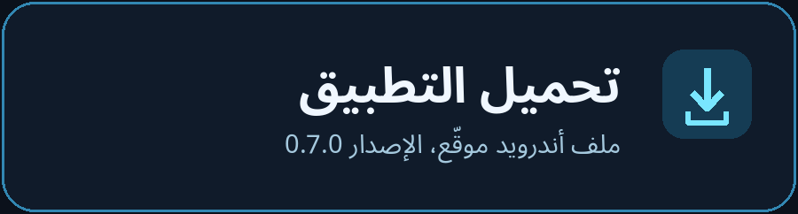</a></td>
    <td width="50%" align="center"><a href="https://github.com/nexvary/NEXVARY-Tower/releases/download/v0.7.0/NEXVARY-Tower-Guard-0.7.0-vc10-release.apk">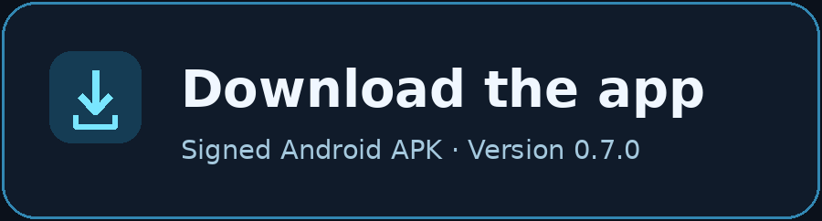</a></td>
  </tr>
</table>

<a href="https://github.com/nexvary/NEXVARY-Tower/releases/download/v0.7.0/NEXVARY-Tower-Guard-0.7.0-vc10-release.apk"><strong>تحميل مباشر للـAPK · Direct APK download</strong></a> Android 10+ · 0.7.0 · Build 10

## كيف يحدث اعتراض المكالمات؟ · How could a call be intercepted?

<strong>Tower Guard أداة دفاعية ترصد مؤشرات الخطر في الشبكة الخلوية.</strong> <strong>Tower Guard is a defensive tool for spotting unusual cellular activity.</strong>

<table align="center">
  <tr>
    <td width="50%" align="center"><a href="docs/media/tower-network-illustration-ar.png">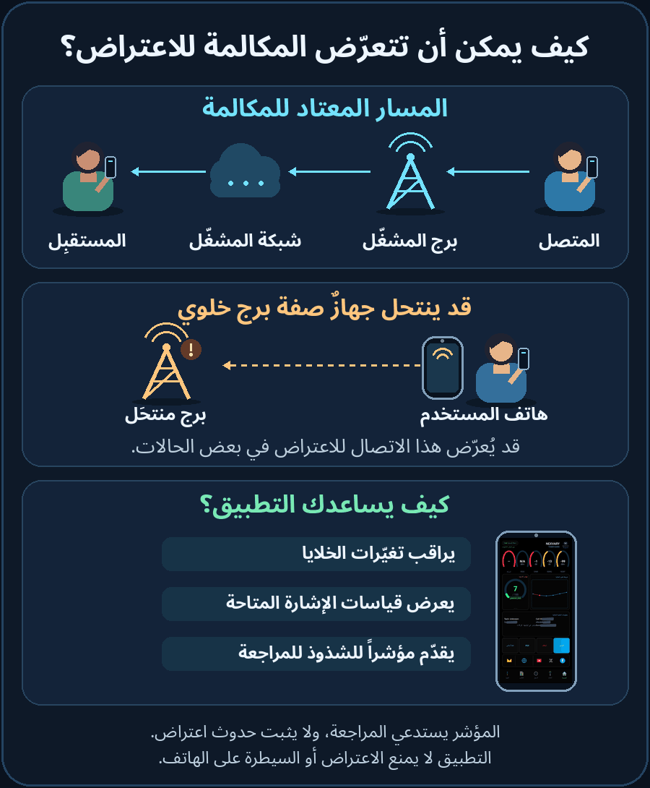</a></td>
    <td width="50%" align="center"><a href="docs/media/tower-network-illustration-en.png">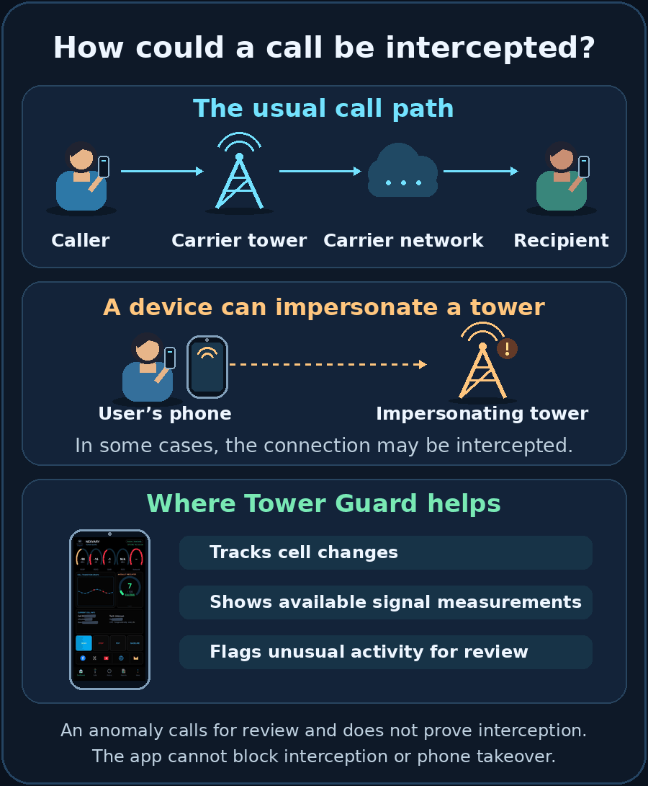</a></td>
  </tr>
</table>

<a href="https://sls.eff.org/technologies/cell-site-simulators-imsi-catchers">عن محاكيات الأبراج الخلوية · About cell-site simulators (EFF)</a>

## العربية

<strong>تابع تغيّرات الشبكة الخلوية من هاتفك.</strong> يعرض Tower Guard قياسات الإشارة التي يتيحها Android، ويرسم تسلسل تغيّر الخلايا ويعرض مؤشر شذوذ قابلًا للمراجعة.

<ul>
<li><strong>لوحة مراقبة مباشرة</strong> تعرض قوة الإشارة وجودتها وتغيّرات الخلايا أثناء فتح التطبيق.</li>
<li><strong>سجل محلي مشفّر</strong> مع خطوط أساس موثوقة وتقارير PDF يختار المستخدم مشاركتها.</li>
<li><strong>عربي وإنجليزي</strong> مع واجهة عربية من اليمين إلى اليسار ومركز توعية أمنية يعمل دون اتصال.</li>
</ul>

<h3>لقطات فعلية من الهاتف</h3>

أُخفيت بيانات المشغّل ومعرّفات الخلية والقناة في الصور المنشورة.

<table>
  <tr>
    <td align="center"><a href="docs/media/dashboard-ar.jpg">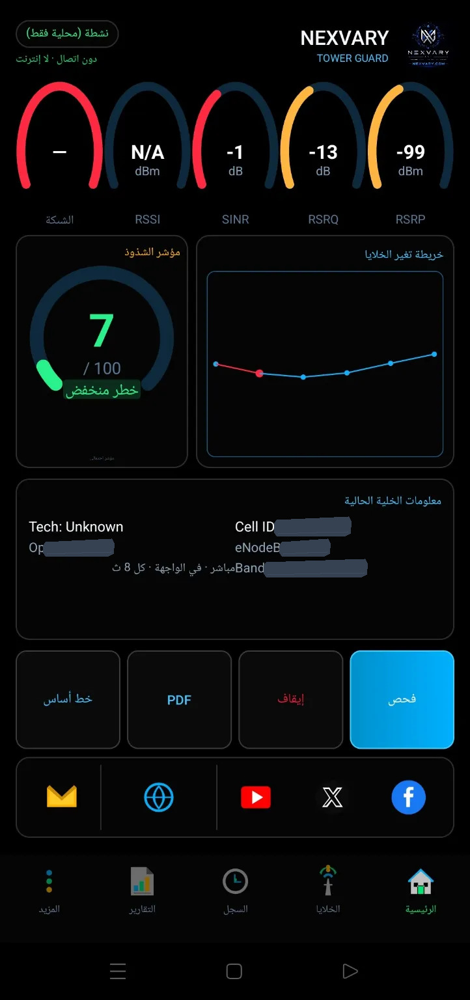</a> <strong>لوحة المراقبة</strong></td>
    <td align="center"><a href="docs/media/security-center-ar.jpg">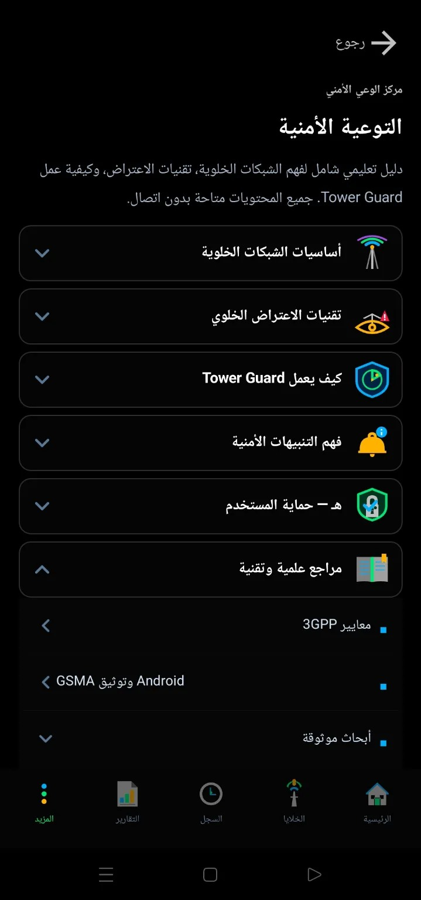</a> <strong>مركز التوعية الأمنية</strong></td>
  </tr>
  <tr>
    <td align="center"><a href="docs/media/settings-ar.jpg">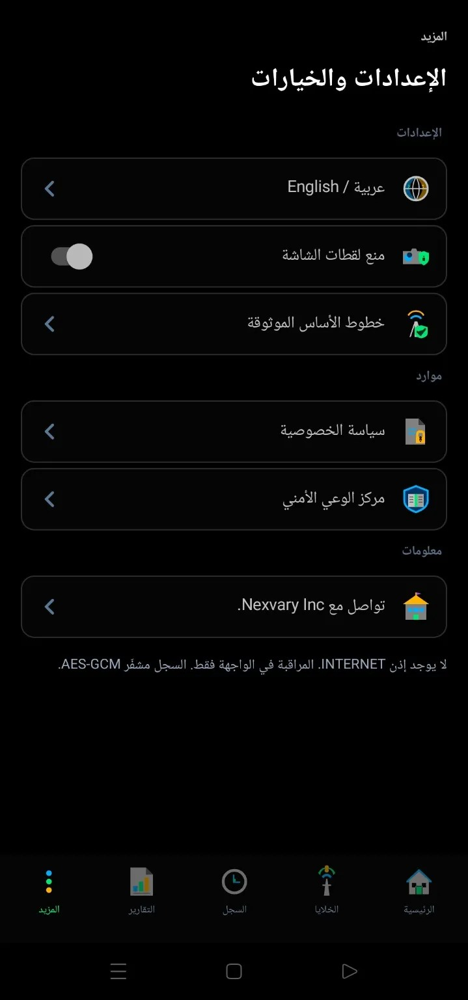</a> <strong>الإعدادات</strong></td>
    <td align="center"><a href="docs/media/contact-ar.jpg">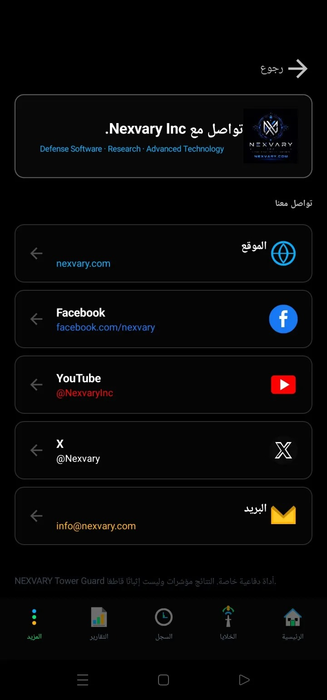</a> <strong>تواصل مع Nexvary</strong></td>
  </tr>
</table>

<h3>التثبيت والخصوصية</h3>

اضغط «تحميل التطبيق»، ثم افتح ملف APK على هاتفك واتبع التعليمات.

يُجري التطبيق التحليل على الجهاز دون إذن الإنترنت. تختلف القياسات المتاحة حسب الهاتف والشبكة والأذونات. مؤشر الشذوذ يساعدك على تحديد ما يستحق المراجعة، ولا يكفي وحده لإثبات اعتراض الاتصالات.

<strong>تواصل مع Nexvary Inc.</strong> 
<a href="https://nexvary.com/">الموقع الرسمي</a> · <a href="https://www.facebook.com/share/14p9krEn5ij/">فيسبوك</a> · <a href="https://www.youtube.com/@NexvaryInc">يوتيوب</a> · <a href="https://x.com/Nexvary">X</a> · <a href="mailto:info@nexvary.com">البريد الإلكتروني</a>

## English

**See how your phone's cellular network changes.** Tower Guard displays the signal measurements Android makes available, charts cell transitions, and gives you an anomaly indicator to investigate.

- **Live dashboard** for available signal measurements and cell transitions while the app is open.
- **Encrypted local history** with trusted baselines and PDF reports you can choose to share.
- **English and Arabic** with a right-to-left Arabic interface and an offline security knowledge center.

### Real screenshots

Carrier details and cell and channel identifiers are masked in the dashboard captures. The Arabic gallery above includes the Security Knowledge Center.

<table>
  <tr>
    <td align="center"><a href="docs/media/dashboard-en.jpg">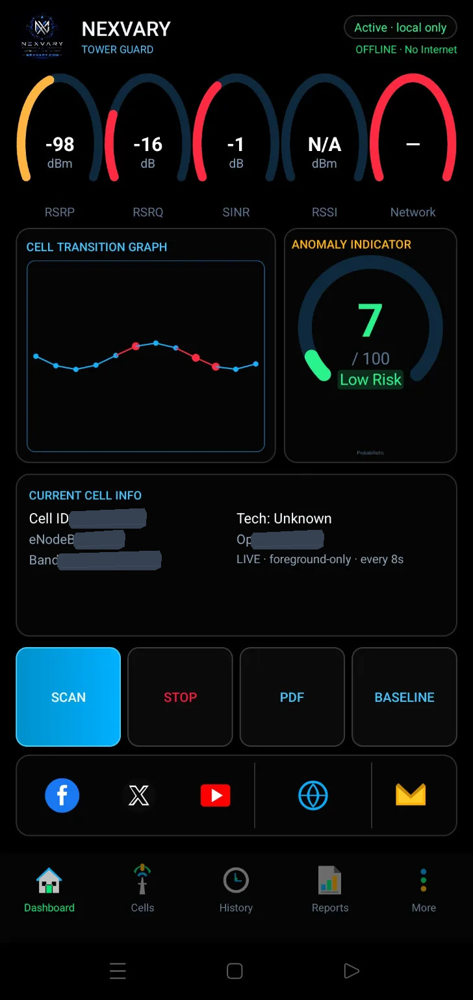</a> <strong>Dashboard</strong></td>
    <td align="center"><a href="docs/media/settings-en.jpg">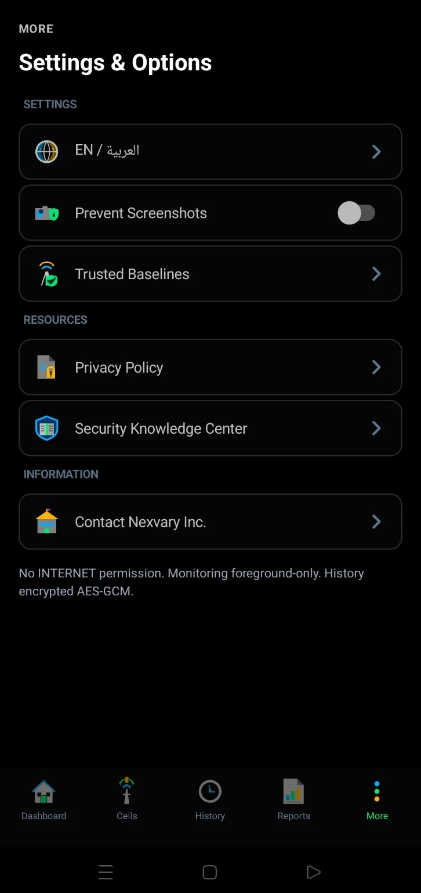</a> <strong>Settings</strong></td>
    <td align="center"><a href="docs/media/contact-en.jpg">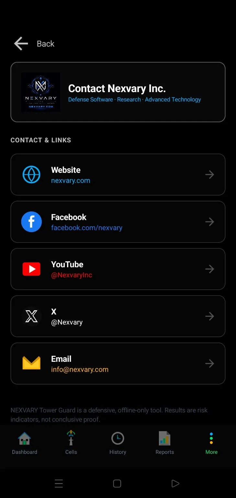</a> <strong>Contact Nexvary</strong></td>
  </tr>
</table>

### Install and privacy

Select **Download the app**, open the APK on your Android phone, and follow the installation prompt.

Analysis runs on your phone without Internet permission. Available measurements depend on the device, network and permissions. The anomaly indicator can guide review, but cannot establish whether interception occurred.

**Contact Nexvary Inc.**  
[Website](https://nexvary.com/) · [Facebook](https://www.facebook.com/share/14p9krEn5ij/) · [YouTube](https://www.youtube.com/@NexvaryInc) · [X](https://x.com/Nexvary) · [Email](mailto:info@nexvary.com)

### Verification · التحقق من الإصدار

[Release notes and files · ملفات الإصدار](https://github.com/nexvary/NEXVARY-Tower/releases/tag/v0.7.0) · [Source for this release · مصدر هذا الإصدار](https://github.com/nexvary/NEXVARY-Tower/tree/v0.7.0)

| Check · البيان | Value · القيمة |
| --- | --- |
| Android package | `com.nexvary.imsi` |
| APK SHA-256 | `e48f986f391fc4d265848957eb201a67e8057c16b25140f74b407b70ef5e2a3f` |
| Signing certificate SHA-256 | `eb79a4e6c1b03bc5a1b8ca04b65afac672744d4bf8e3cbd2092c2eba08171725` |
